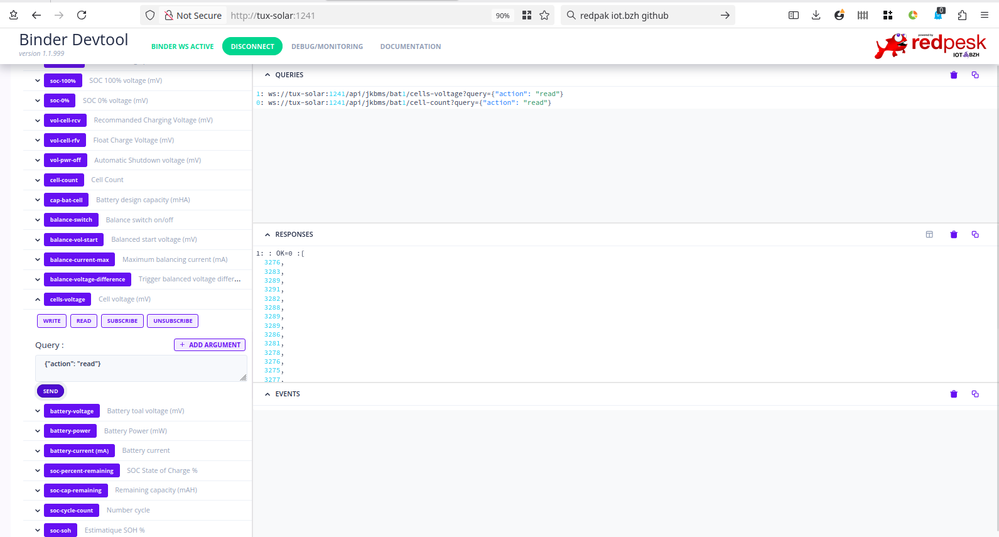

# JKbms Modbus Water meeter redpesk binding

### Modbus TTY config:
 * baud: 115200(default) 9600(avaliable by config) 
 * parity: none
 * slave-id: 1 
 * reference: https://github.com/phinix-org/Multiple-JK-BMS-by-Modbus-RS485

### Device configuration:
 * slave-id set by from panel DIP switch 
 * connect to RS485 port with tty/USB or RS485/RTU gateway
 * debug connectivity with OpenModScan or equivalent Modbus debug tool
 * reference: https://cleversolarpower.com/jk-bms-settings/

### WARNING: 
 * should use bluetooth JKBMS application to check/configure modbus protocol is configure on port RS485
 * check "ever solar power" to understand your Lithium cells configuration https://cleversolarpower.com/jk-bms-settings/

### afb-binder configuration files

* etc/modbus-jkbms-battery: describes working sensors (warning set slave-id to your configured value)
* etc/mqtt-jkbms-battery: publish net-flow through mqtt
* homeassistant/sensors/jkbms-mqtt-sensors.yaml: create jkbms sensor without HA MQTT group
* systemd/jkbms.service: systemd startup service 

### JKBMS config bluetooth application

### Debug UI

### Home-Assistant

### Modbus scan

A nice tool to scan modbus registers: https://github.com/sanny32/OpenModScan/releases

